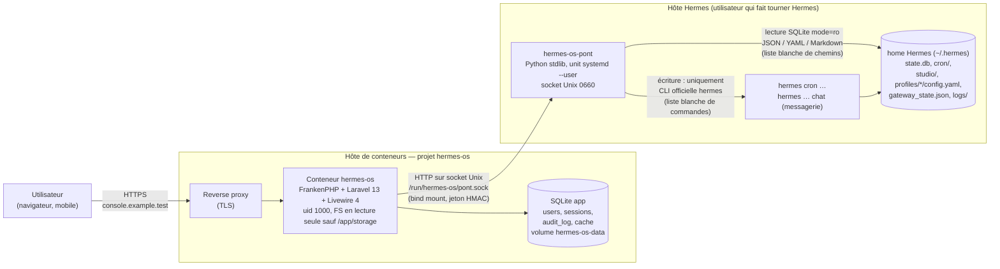

# Architecture — hermes-os v1

> cto, 08/10/2026, mis à jour au lot 01 de l'équipe (03/11/2026) : Kanban et Terminal retirés. Les choix structurants sont détaillés dans `docs/adr/`. Versions vérifiées le 08/10/2026 (section « Versions »).

## Vue d'ensemble



Principe : **le conteneur web ne voit aucun fichier de Hermes.** Il ne connaît qu'un socket Unix. Tout ce qui touche Hermes passe par un petit service hôte, `hermes-os-pont`, qui n'expose qu'une liste fermée de lectures et d'actions (ADR 0002). Quand Hermes tourne sur une autre machine, le même pont appelle la console en HTTPS sortant, avec des requêtes signées, et aucun socket n'est monté (pilote `distant`, ADR 0009).

## Composants
| Composant | Rôle | Techno |
|---|---|---|
| `hermes-os` (app) | Interface, authentification, journal d'audit, cache des lectures | Laravel 13, Livewire 4 (mode `csp_safe`), Fortify (sans vues), Tailwind 4, Vite 8 |
| Base de l'app | Compte unique, sessions, journal d'audit, cache | SQLite (fichier sur volume) |
| `hermes-os-pont` | API JSON locale : lectures filtrées + actions en liste blanche | Python 3.13 stdlib (déjà sur l'hôte), ~300 lignes, dans le dépôt sous `pont/` |
| Dev local | Démarrage d'un clone neuf | Sail (runtime PHP 8.5) + **pont factice** (`HERMES_PONT_DRIVER=demo`, jeu de données figé) |
| Prod | Image unique | `Dockerfile` multi-étapes, base `dunglas/frankenphp:1.13-php8.5` (ADR 0006) |

## Flux de lecture
1. Un composant Livewire demande `HermesClient::planifiees()`.
2. `HermesClient` (interface, 2 implémentations : `PontClient`, `DemoClient`) appelle `GET /v1/cron` sur le socket, avec un en-tête `X-Pont-Signature` (HMAC-SHA256 du corps + horodatage, secret partagé, fenêtre 30 s).
3. Le pont lit `cron/jobs.json` (et `state.db` en `file:…?mode=ro` pour les sessions), sélectionne **des colonnes nommées** (jamais `*`), renvoie du JSON.

« À décider » (accueil) = `GET /v1/a-decider` : approbations en attente et questions des managers dans la messagerie. « En cours » = sessions d'agents actives (`GET /v1/consommation/sessions`).
4. Laravel met en cache 3 à 5 s (évite de marteler les SQLite pendant le `wire:poll`).

**Filtrage des secrets, en 3 couches** :
- le pont n'a **aucune route** vers `.env`, `auth.json`, `~/.config`, `vault/`, `auth.lock`, `pairing/` (liste blanche de chemins, résolution `realpath` + refus des liens symboliques sortants) ;
- pour `config.yaml` des profils, le pont ne renvoie que `model` et les skills actifs, jamais le reste ;
- les textes libres (sorties cron, messages, logs) passent par un **masqueur** (motifs : `sk-…`, `ghp_…`, `xox…`, `AKIA…`, JWT, `Bearer …`, `password=`, clés PEM) côté pont, et un test automatisé vérifie qu'aucun motif ne sort.

## Flux d'écriture
1. L'utilisateur clique « Lancer maintenant » → confirmation explicite dans l'interface.
2. Laravel vérifie : session valide, **TOTP confirmé depuis moins de 15 min** pour toute action (sinon redemande du code), limitation 20 actions/min.
3. Laravel écrit d'abord une ligne `audit_log` (`pending`), appelle `POST /v1/actions/cron.run {job_id}`.
4. Le pont valide le format de chaque argument (`job_id` = `^[a-f0-9]{12}$`, interlocuteur = profil existant, texte ≤ 4 000 caractères), puis exécute **`hermes cron run <id>`** via `subprocess.run([...], shell=False)` avec un délai de 30 s.
5. Le pont renvoie code de sortie + sortie standard masquée ; Laravel complète la ligne d'audit (`ok`/`failed`).

Actions (liste fermée) : `cron.run`, `cron.pause`, `cron.resume`, et celles de la messagerie et du coffre (ADR 0008, `pont/contrat.json`). Les actions kanban ont été retirées au lot 01. Rien d'autre n'est exécutable, aucun argument libre n'atteint un shell.

Pourquoi la CLI et pas l'`api_server` de Hermes : voir ADR 0002 (l'`api_server` donne l'accès complet à l'agent, outils système compris).

## Sécurité (résumé ; détail ADR 0003 et 0004)
- **Réseau** : HTTPS terminé par le reverse proxy ; aucun port publié par le conteneur ; le pont n'écoute sur **aucun port TCP** (socket Unix seulement, permissions `0660`, groupe de l'utilisateur hôte).
- **Authentification** : un seul compte créé par `php artisan hermes-os:compte` (pas d'inscription, pas de réinitialisation de mot de passe par e-mail) ; mot de passe ≥ 16 caractères vérifié contre Have I Been Pwned (`Password::uncompromised()`) ; **TOTP obligatoire** (Fortify), codes de récupération ; aucune page n'est accessible avant la confirmation TOTP.
- **Limitations** : 5 tentatives / min / IP+identifiant à la connexion, 5 / min sur le code TOTP, verrouillage 15 min après 10 échecs.
- **Sessions** : driver `database`, durée 30 min d'inactivité, 12 h max absolu, cookie `Secure`, `HttpOnly`, `SameSite=Strict`, régénération à la connexion, déconnexion des autres appareils possible.
- **Journal d'audit** : connexions (réussies/échouées), TOTP, chaque action d'écriture (qui, quoi, arguments, IP, résultat). Consultable dans la console, non modifiable depuis l'interface.
- **En-têtes** : CSP stricte avec nonce (`default-src 'self'; script-src 'self' 'nonce-…'; style-src 'self' 'nonce-…'; img-src 'self' data:; frame-ancestors 'none'; form-action 'self'; base-uri 'none'`), Livewire en mode `csp_safe` (pas d'`unsafe-eval`), HSTS 1 an, `X-Content-Type-Options`, `Referrer-Policy: no-referrer`, `Permissions-Policy` vide, `X-Robots-Tag: noindex, nofollow`.
- **Liste d'IP (option)** : variable `HERMES_OS_IP_ALLOWLIST` (CIDR, vide = désactivée), appliquée par middleware ; `TrustProxies` limité à `HERMES_OS_TRUSTED_PROXIES` (CIDR du reverse proxy, vide par défaut = aucun proxy de confiance).
- **Conteneur** : utilisateur non root (uid 1000 pour accéder au socket), système de fichiers en lecture seule hors `/app/storage`, pas de `docker.sock`.

## Temps réel
`wire:poll.5s` sur l'accueil et la messagerie, `wire:poll.30s` ailleurs, suspendu quand l'onglet est caché (comportement natif de Livewire). Pas de Reverb/WebSocket en v1 (ADR 0005).

## Déploiement
- Image `Dockerfile` (FrankenPHP/Caddy en HTTP sur **:8080**), derrière un reverse proxy qui porte le TLS. Branche de déploiement `main` (merge `develop` → `main` par le responsable du dépôt).
- Montages : **aucun montage du home Hermes** dans le conteneur (ADR 0002) ; seul le dossier du socket du pont est monté.
- Variables : `APP_KEY`, `APP_URL`, `HERMES_OS_CLIENT` (optionnel), `HERMES_OS_TRUSTED_PROXIES` (CIDR du proxy), `HERMES_PONT_SOCKET=/run/hermes-os/pont.sock`, `HERMES_PONT_SECRET`, `HERMES_OS_IP_ALLOWLIST` (optionnel) — saisies dans l'outil de déploiement, jamais dans le dépôt.
- Volumes : `hermes-os-data` → `/app/storage` (SQLite + logs) ; bind mount du dossier du socket (`~/.local/state/hermes-os/run` par défaut) → `/run/hermes-os` (**dossier dédié**, rien d'autre du home Hermes).
- Healthcheck : `GET /up` (route Laravel native).
- Pont : unit `systemd --user` `hermes-os-pont.service` (fichier fourni dans `pont/`), installé par Hermes sur l'hôte. Ce n'est **pas** une modification de la configuration de Hermes ; il n'exige aucun redémarrage du gateway.
- Sauvegarde : le fichier SQLite de l'app (seule donnée propre à hermes-os) — copie quotidienne du volume `hermes-os-data`.

## Arborescence prévue du dépôt
```
app/            Laravel (Livewire dans app/Livewire, client Hermes dans app/Hermes)
pont/           hermes_os_pont.py, tests, hermes-os-pont.service, README
docs/           cadrage.md, architecture.md, adr/
docker/         configuration FrankenPHP (Caddyfile), entrypoint
Dockerfile      production
compose.yaml    Sail (dev) — pont en mode démo, aucune dépendance à Hermes
scripts/verifier-clone-neuf.sh
```

## Versions vérifiées le 08/10/2026
| Paquet | Version | Source |
|---|---|---|
| laravel/framework | v13.35.0 (06/10/2026), PHP ^8.3 | Packagist |
| laravel/laravel (squelette) | v13.11.0 (30/09/2026) | Packagist |
| livewire/livewire | v4.4.7 (28/09/2026) | Packagist |
| laravel/fortify | v1.41.0 (28/09/2026) | Packagist |
| laravel/sail | v1.68.0 (18/09/2026), runtimes jusqu'à 8.5 | Packagist, GitHub `laravel/sail/runtimes` |
| pragmarx/google2fa (via Fortify) | v9.1.0 | Packagist |
| bacon/bacon-qr-code (via Fortify) | v3.1.1 | Packagist |
| spatie/laravel-csp | 3.29.0 (09/09/2026), PHP ^8.3 | Packagist |
| pestphp/pest | v5.3.1 (07/10/2026), PHP ^8.4 | Packagist |
| tailwindcss | 4.3.3 | npm |
| vite | 8.3.4 | npm |
| alpinejs | 3.17.4 (embarqué par Livewire) | npm |
| PHP | 8.5.11 (fin de support 31/12/2029) | endoflife.date |
| FrankenPHP | v1.13.0 (04/10/2026), image `dunglas/frankenphp:1.13-php8.5` | GitHub, Docker Hub |
| Python hôte (pont) | 3.13.5, SQLite 3.46.1 | `/usr/bin/python3` |

À revérifier le jour où `dev` initialise le projet (lot 04) : on prend la dernière version stable de ce jour-là.
